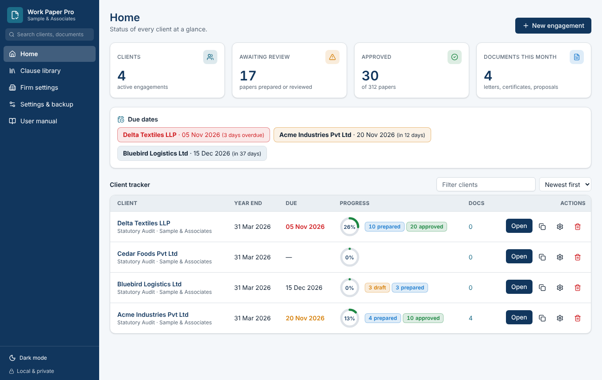
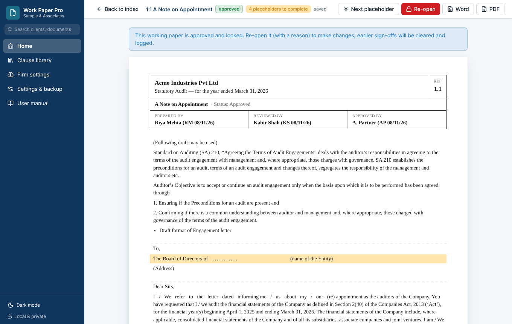
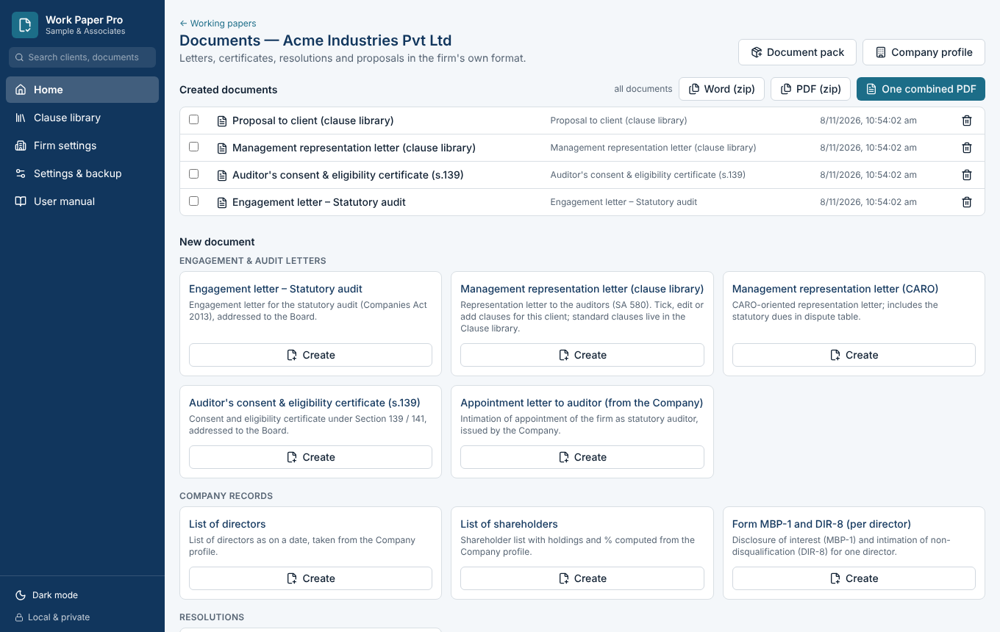
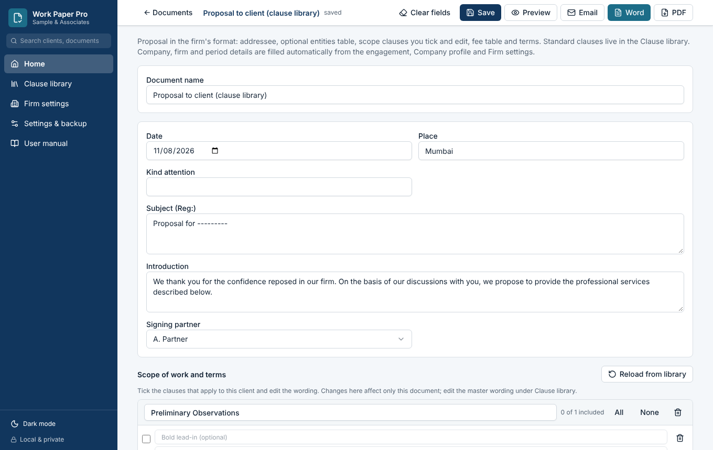
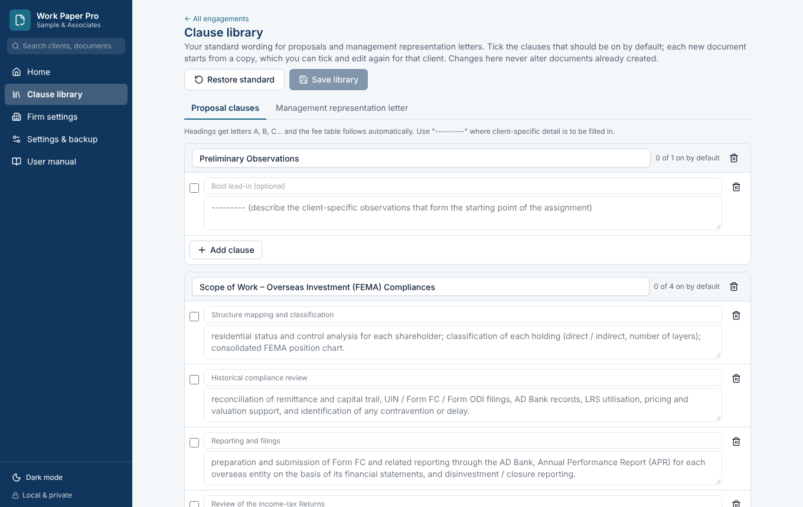
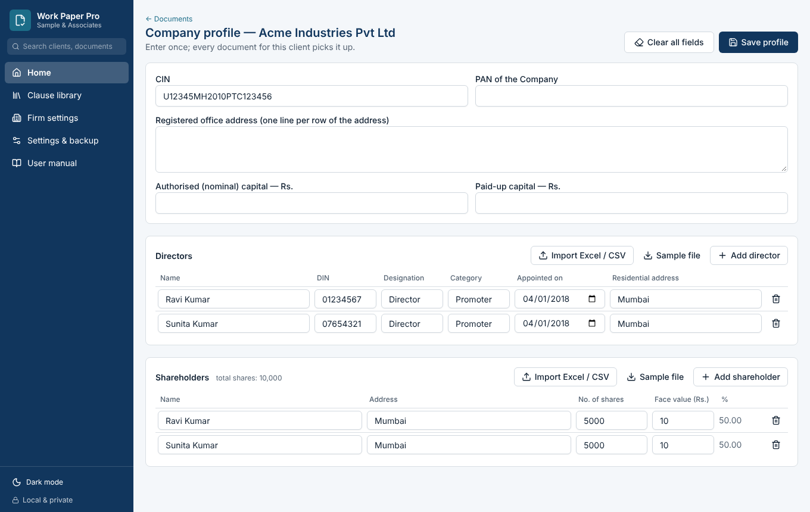
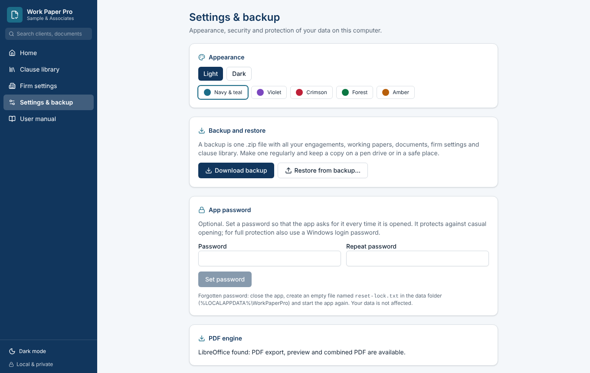
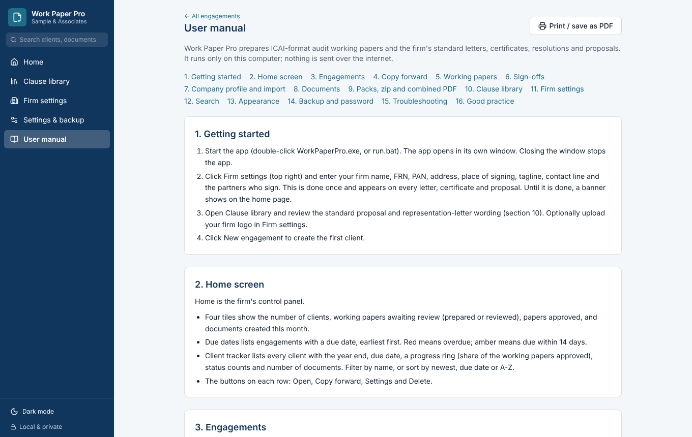
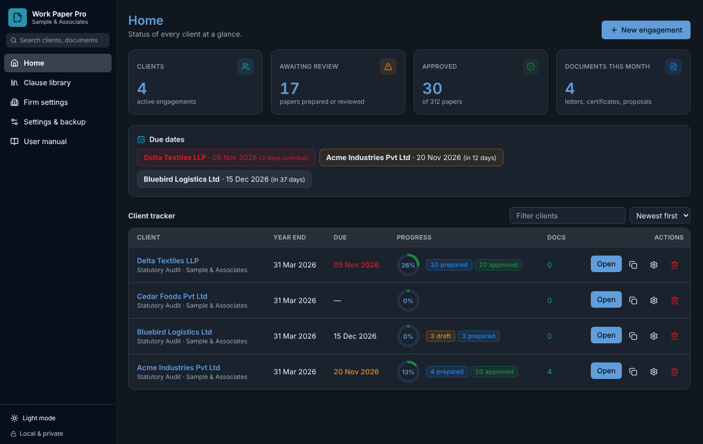

# Work Paper Pro

**Automated ICAI-format audit working papers and standard professional documents, running privately on the auditor's own computer.**

Work Paper Pro turns the ICAI *Audit Working Paper Templates* (78 working-paper units) into ready-to-use, client-specific working papers with preparer / reviewer / approver sign-offs, and generates the firm's everyday documents (engagement letters, representation letters, certificates, resolutions and proposals) from a company profile entered once. All data stays on the local PC; nothing is sent to the internet.

> Built for the AICA Level 2 capstone project (ICAI).



## Why it exists

Preparing working papers by hand means copying the same client details into dozens of Word files, re-typing standard text for every engagement, and tracking review status in spreadsheets. Documents for the same client (engagement letter, consent, representation letter, MBP-1, DIR-8, certificates) repeat the same facts again. Standard proposal wording is copied from the last client's file, risking another client's details appearing in a new document.

## Features

| Area | What it does |
|---|---|
| **78 working papers** | Built from the ICAI template. Client name, period, and applicable text are filled automatically; text that depends on the engagement is adjusted by rules; remaining placeholders are highlighted and counted. |
| **Maker-checker sign-off** | Draft, Prepared, Reviewed, Approved. A signed paper is locked; re-opening needs a reason; the reviewer must differ from the preparer. Full activity log. |
| **Documents module** | 12 templates: engagement letter, two management representation letters, auditor consent, appointment intimation, list of directors, list of shareholders, MBP-1 and DIR-8, board resolution, turnover certificate, net worth certificate (computed), and proposal. |
| **Company profile** | Enter directors, shareholders and company details once; they flow into every document. Import from Excel / CSV. |
| **Clause library** | Standard proposal and representation-letter clauses. Tick and edit per client; the library itself is editable. Documents keep their own copy. |
| **Document packs** | Create the whole appointment set in one click, with one MBP-1 / DIR-8 per director. |
| **Export** | Word and PDF per document, zip of many documents, or one combined PDF with page numbers. Warns about any blank left in a document before export. |
| **Dashboard** | Clients, papers awaiting review, approvals, due dates and a client tracker with progress rings. |
| **Copy forward** | Start next year's engagement from the previous one. |
| **Firm-neutral** | No firm details ship with the app. Each firm sets its own name, FRN, partners, logo and letterhead. |
| **Safety** | Backup / restore as one zip, optional app password, search, light / dark mode, in-app user manual. |

## Screenshots

| | |
|---|---|
|  Working paper with sign-offs and highlighted placeholders |  Documents, packs and export |
|  Tick-and-edit clauses in a proposal |  Clause library |
|  Company profile with Excel import |  Backup, password and appearance |
|  Built-in user manual |  Dark mode |

(The clients shown are fictional.)

## How it works

```
Browser window (React + Tailwind, built to static files)
        |  HTTP on 127.0.0.1 only
FastAPI server  --  SQLite database in %LOCALAPPDATA%\WorkPaperPro
        |
  catalog/      78 working-paper models generated from the ICAI .docx
  doctemplates/ Word templates with {{tokens}}, repeating rows and clause slots
```

* `app/doctpl.py` fills Word templates directly at the XML level: run-aware token replacement, repeating table rows, conditional sections, clause slots, Indian number format and amount in words, computed net-worth tables.
* `app/docxfill.py` and `app/catalog.py` build and fill the working-paper models.
* `app/extras.py` adds import, packs, zip / combined PDF, search, backup / restore and the optional password.
* Security: the server accepts only local connections and same-origin writes.

## Install (Windows)

1. Install **Python 3.10 or newer** from python.org (tick *Add python.exe to PATH*).
2. Download this repository and get the ICAI **Audit Working Paper Templates** .docx. Save it in this folder as `ICAI-Audit-Working-Paper-Templates.docx` (or drag it into the window when asked).
3. Double-click **`setup.bat`**. It installs the libraries and builds the 78 working-paper templates (about 15 seconds).
4. Double-click **`run.bat`** to start.
5. Open **Firm settings** and enter your firm details; then create your first engagement. The **User manual** in the left panel explains every screen.

To make a stand-alone `.exe` for other computers, run `build_exe.bat` after `setup.bat`.

### Running from Python / IDLE
Open `launcher.py` in IDLE and press F5. Missing libraries are installed automatically (internet needed once). Manual install, one line:

```
pip install fastapi uvicorn lxml docx2pdf pypdf reportlab
```

`docx2pdf`, `pypdf` and `reportlab` are optional (PDF through Microsoft Word, combined PDF with page numbers). LibreOffice also works for PDF.

### Rebuilding the front end (optional)
The built screens are already in `ui/dist`. To change them: `cd frontend`, `npm install`, `npm run build`, then copy `frontend/dist` over `ui/dist`.

## Technology

Python, FastAPI, SQLite, lxml (Word XML), React 19, TypeScript, Tailwind CSS, TanStack Router and Query. The application was designed and built with AI assistance (Claude), with the professional design and review by the author.

## Notes and limits

* Working-paper content comes from the ICAI publication; templates are not redistributed in this repository, they are generated locally from the user's copy.
* Generated documents are drafts for professional review. Always read an exported document before issue.
* PDF export, preview and combined PDF need LibreOffice or Microsoft Word.
* There is no direct Tally integration; use Tally's Excel export with the import feature.

## Author

Anurag Dave, Chartered Accountant. AICA Level 2 capstone submission.
